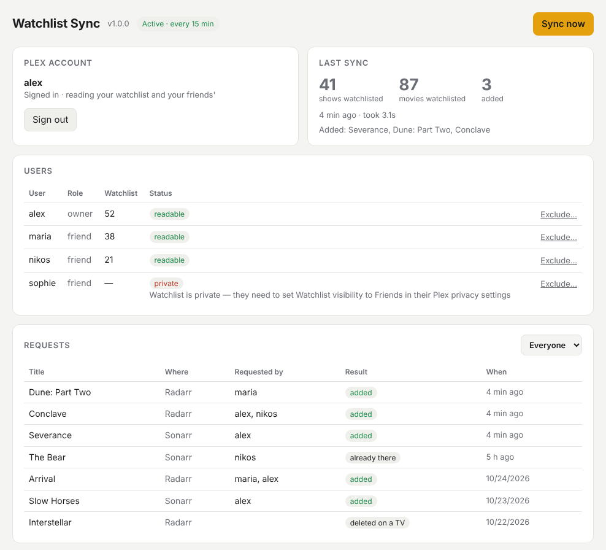

# watchlist-sync

**Your household's Plex Watchlists, downloaded automatically.** Add a movie or show to
your Plex Watchlist, from any Plex app, and watchlist-sync hands it to Radarr or Sonarr.
It reads your friends' Watchlists too, so everyone you share your server with can
request things without a separate request app.

[](https://github.com/DarkAngelGR/watchlist-sync/releases/latest)
[](LICENSE)

<p align="center">
  
</p>

## What it does

- **Movies go to Radarr, shows go to Sonarr**, matched by TMDB and TVDB ids, and are
  searched for right away.
- **Everyone's Watchlist counts:** the server owner's and every friend's you share the
  server with. Each title is tagged `plex-<username>` in Sonarr/Radarr, so you can see
  who asked for what.
- **Anime is handled as anime:** pick an anime root folder (and profile) under Settings,
  and shows TheTVDB calls anime, or Japanese animation, are added there as series type
  *Anime* (absolute episode numbers). Leave it empty and anime is added like any show.
- **Bazarr is told** to pick up new titles straight away, so subtitles follow.
- **Dry run first:** it starts by only showing what it *would* add.
- **Excluding someone** stops syncing their Watchlist and can remove what only they
  asked for, files included. A preview shows exactly what goes and what stays.
- **A web page** for signing in with Plex, settings, users and request history.
  No config files to edit.

## Getting started

You need Docker, a Plex Media Server you own, and Sonarr and/or Radarr.

1. Save this as `docker-compose.yml` in a new folder (or download the one in this repo):

   ```yaml
   services:
     watchlist-sync:
       image: ghcr.io/darkangelgr/watchlist-sync:latest
       container_name: watchlist-sync
       network_mode: host
       environment:
         - TZ=Europe/London        # your time zone
         - UI_PASSWORD=change-me   # optional, recommended
       volumes:
         - ./data:/data
       restart: unless-stopped
   ```

2. Start it: `docker compose up -d`
3. Open **http://&lt;server-ip&gt;:8789** and:
   1. **Sign in with Plex** using the account that owns the server. Plex's own sign-in
      page opens; there's nothing to copy.
   2. Under **Settings**, enter the Sonarr address and API key (Sonarr › Settings ›
      General), press **Test & load options**, and pick a quality profile and root folder.
      Do the same for Radarr, and for Bazarr if you use it.
   3. **Save.** The first syncs are a dry run: **Last sync** shows what would be added.
      When it looks right, untick **Dry run** and save again.

To update: `docker compose pull && docker compose up -d`. Settings, the Plex sign-in
and the history live in `./data`.

<details>
<summary><b>Build it yourself instead</b></summary>

```sh
git clone https://github.com/DarkAngelGR/watchlist-sync.git
cd watchlist-sync
# in docker-compose.yml, swap the image: line for build: .
docker compose up -d --build
```
</details>

## Friends' Watchlists

Only your sign-in is needed. Each friend has to allow it once: in their Plex account,
**Privacy › Watchlist** set to **Friends** (or wider). The **Users** card shows whose
Watchlist is readable and who still has theirs private. Managed Plex Home users (no
plex.tv account of their own) don't have a Watchlist Plex shares, so they aren't covered.

## Excluding someone

In **Users**, press **Exclude…** next to a name. Before anything happens, you see:

- **What gets deleted:** titles watchlist-sync added *only* because of that person,
  removed from Sonarr/Radarr **with their files**. Untick this to just stop syncing
  their Watchlist.
- **What's kept:** titles someone else also asked for or still has listed. Those stay;
  only the person's `plex-<name>` tag is removed.

Anything that was in your library before watchlist-sync is never deleted. In dry run
nothing is deleted at all. **Include again** brings the person back on the next sync.

## How it behaves

- Each title is handled once. Delete something from Sonarr/Radarr yourself and it
  isn't re-added just because it's still on a Watchlist.
- Removing a title from a Watchlist doesn't delete it from your library.
- It syncs every 15 minutes by default (Settings), or right away with **Sync now**.
- The Plex sign-in is refreshed daily so it doesn't expire.
- Settings can be pre-filled with environment variables (see `.env.example`); values
  saved on the web page win.

## Security

The web page stores your Plex sign-in and Sonarr/Radarr API keys, so:

- Set `UI_PASSWORD` (any username works in the browser prompt).
- Keep it on your home network or a VPN such as Tailscale. Don't expose it to the
  internet through a reverse proxy or tunnel.

It also refuses requests that another website could make through your browser:
commands are only accepted from its own page, the Orama TV app, or other devices on
your network, and it only answers to an IP address or a local name (`nas.local`,
a bare machine name, a Tailscale `*.ts.net` name). If you reach it by another name,
for example behind a reverse proxy, add that name to `ALLOWED_HOSTS`
(comma-separated) in the environment.

Your API keys never leave the container: the web page and the TV endpoints below only
ever see what's been requested, not the keys.

## Orama (Samsung TV)

[Orama](https://github.com/DarkAngelGR/orama), a Plex and Jellyfin player for Samsung TVs,
works with watchlist-sync. On Plex, you can search Plex's whole catalog from the TV and add
titles to your Watchlist, and watchlist-sync syncs right away. On Jellyfin, which has no
Watchlist, Orama searches through Sonarr/Radarr instead and **Request** adds the title
directly, with the same profiles, folders and anime handling as a Watchlist add. Orama also shows download progress,
lists the parts of a collection you don't have yet, shows upcoming episodes, searches
Bazarr for subtitles, and can delete titles from Sonarr/Radarr. It finds watchlist-sync by itself when it runs on the same machine as
Plex or Jellyfin (port 8789).

<details>
<summary><b>TV endpoints</b></summary>

These are the only endpoints that allow cross-origin calls. They need `UI_PASSWORD`
(HTTP Basic, any username) when it's set.

| Endpoint | What it does |
| --- | --- |
| `GET /api/tv` | Version, what's set up, and whether Sonarr/Radarr answer |
| `POST /api/tv/sync` | Start a sync now (after a Watchlist add) |
| `GET /api/tv/queue` | What Sonarr/Radarr are downloading, per movie/series, plus recent adds still being searched for |
| `GET /api/tv/collection?tmdb=ID` | The Radarr collection a movie belongs to, every part, and which ones you have |
| `GET /api/tv/upcoming?days=7` | Episodes airing in the next days (Sonarr's calendar) that aren't downloaded yet |
| `GET /api/tv/subtitles?kind=movie\|episode&…` | Search Bazarr for subtitles (`tmdb`/`imdb` for a movie; the show's `tvdb` plus `season` and `episode`; optional `lang`). Returns a token and the results |
| `POST /api/tv/subtitles/download` | `{token, index}`: download one of those results through Bazarr. Bazarr's own subtitle ids never leave watchlist-sync |
| `GET /api/tv/lookup?kind=movie\|show&q=TEXT` (or `&id=ID`) | Search Radarr/Sonarr's lookup (or one TMDB/TVDB id). Each result says whether it's already there: `have`, `requested` or `none` |
| `POST /api/tv/request` | `{kind: "movie"\|"show", tmdb\|tvdb, user}`: add it to Radarr/Sonarr like a Watchlist add would (nothing in dry run) |
| `POST /api/tv/delete` | `{kind: "movie"\|"show", tmdb\|tvdb, imdb}`: delete from Radarr/Sonarr with files (nothing in dry run). It isn't re-added while it stays on the same Watchlists; adding it to a Watchlist again later brings it back |
</details>

## For developers

`app.py` is the whole service (Python standard library plus `requests`); `ui.html` is the
web page; `python test_app.py` runs the tests against fake Plex/Sonarr/Radarr servers.
Releases are published when `VERSION` in `app.py` changes on `main`.

## License

[MIT](LICENSE) © 2026 Aggelos (DarkAngelGR).

Not affiliated with or endorsed by Plex, Inc., Sonarr, Radarr or Bazarr.
